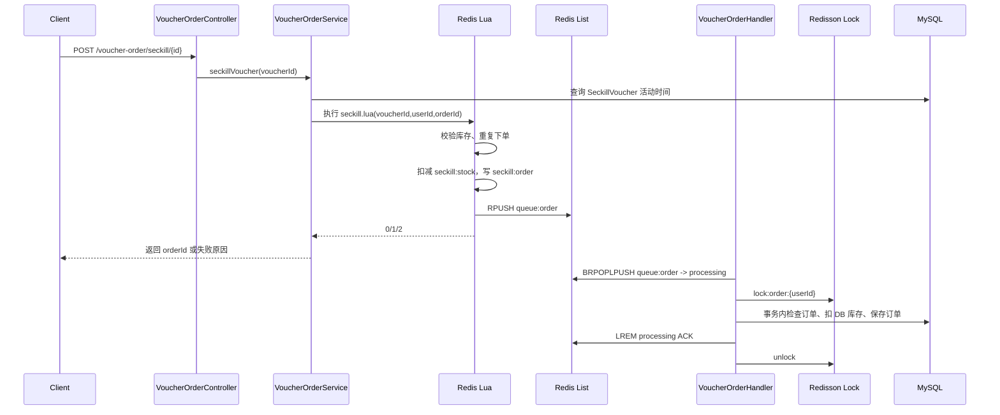

# 黑马点评项目工程化审计

审计范围：`hm-dianping` Spring Boot 后端、Redis/Lua 脚本、MyBatis-Plus 实体服务、基础 SQL 结构和现有测试。本文只做工程化审计，不新增业务功能。

## 1. 项目模块结构

```text
hm-dianping/
  src/main/java/com/hmdp/
    config/        Spring MVC、MyBatis-Plus、Redisson、全局异常处理
    controller/    用户、店铺、店铺类型、优惠券、秒杀订单、博客、关注、上传接口
    dto/           Result、LoginFormDTO、UserDTO、ScrollResult
    entity/        User、Shop、Voucher、SeckillVoucher、VoucherOrder、Blog、Follow 等表模型
    mapper/        MyBatis-Plus Mapper
    service/       Service 接口
    service/impl/  核心业务实现
    utils/         Redis key 常量、缓存工具、ID 生成器、锁、登录拦截器、UserHolder
  src/main/resources/
    application.yaml
    seckill.lua
    unlock.lua
    mapper/VoucherMapper.xml
    db/hmdp.sql
```

外层仓库还包含 `nginx-1.18.0/html/hmdp` 前端静态资源、`hmdp.sql`、`秒杀抢购.jmx` 压测脚本和 `jedis-demo` 示例工程。

## 2. 核心业务模块

### 登录

- `UserController` 暴露 `/user/code`、`/user/login`、`/user/me`、签到、UV 等接口。
- `UserServiceImpl.sendCode` 校验手机号后，将 6 位验证码写入 `login:code:{phone}`，TTL 为 2 分钟。
- `UserServiceImpl.login` 从 Redis 读取验证码，按手机号查库；用户不存在时创建用户；随后生成 token，把用户 DTO 字段写入 `login:token:{token}` Hash，并刷新 TTL。
- `MvcConfig` 注册两个拦截器：`RefreshTokenIntercepter` order 0 负责解析 token、刷新登录态；`loginIntercepter` order 1 负责需要登录接口的 401 拦截和 ThreadLocal 清理。

### 缓存

- 店铺详情：`ShopServiceImpl.queryById` 使用 `CacheClient.queryWithLogicalExpire` 读取 `cache:shop:{id}`。
- 店铺类型：`ShopTypeServiceImpl.queryTypeList` 使用 `shop:type:list` 缓存列表 10 分钟。
- 店铺更新：`ShopServiceImpl.update` 先更新 DB，再删除 `cache:shop:{id}`。
- 缓存工具：`CacheClient` 支持普通 TTL 缓存、空值缓存、逻辑过期缓存和互斥锁重建。

### 店铺查询

- `/shop/{id}` 查询店铺详情。
- `/shop/of/type` 无坐标时按 `type_id` 分页查库；有坐标时使用 Redis GEO 的 `shop:geo:{typeId}` 做 5km 范围查询，再按距离顺序回表。
- `/shop/geo/load` 将所有店铺按类型写入 Redis GEO。

### 优惠券秒杀

- `VoucherServiceImpl.addSeckillVoucher` 保存普通券、秒杀券，并初始化 `seckill:stock:{voucherId}`。
- `VoucherOrderServiceImpl.seckillVoucher` 先查 DB 校验活动时间，再执行 `seckill.lua`。
- Lua 中完成库存判断、一人一单判断、Redis 库存预扣、用户下单标记、订单消息入队。
- 后台单线程 `VoucherOrderHandler` 使用 Redis List 处理订单消息，落库时用 Redisson 按用户维度加锁。

### 分布式锁

- `SimpleRedisLock` 使用 `SET NX EX` 加锁，`unlock.lua` 校验 owner 后删除锁。
- 秒杀异步落库当前使用 Redisson `RLock`，锁 key 为 `lock:order:{userId}`。
- 缓存重建使用 `CacheClient` 内部的 Redis 互斥锁，锁 key 为 `lock:shop:{id}`。

### 达人探店、点赞、关注、Feed 流

- 探店笔记：`BlogServiceImpl.saveBlog` 保存 blog 后，把 blogId 推送到粉丝的 `feed:{fanUserId}` ZSet。
- 点赞：`BlogServiceImpl.likeBlog` 用 `blog:liked:{blogId}` ZSet 记录点赞用户和时间，同时更新 DB 的 `liked` 字段。
- 点赞列表：`queryLikes` 从 ZSet 取前 5 个用户，再查用户 DTO。
- 关注：`FollowServiceImpl.follow` 写 DB 关注关系，并维护 `follow:{userId}` Set。
- 共同关注：`followCommons` 对两个用户关注 Set 做交集。
- Feed 流：`queryBlogOfFollow` 使用 `reverseRangeByScoreWithScores` 基于 `max + offset` 做滚动分页。

## 3. Redis 使用点

| 场景 | Key | 数据结构 | 写入位置 | 读取位置 |
| --- | --- | --- | --- | --- |
| 登录验证码 | `login:code:{phone}` | String | `UserServiceImpl.sendCode` | `UserServiceImpl.login` |
| 登录态 | `login:token:{token}` | Hash | `UserServiceImpl.login` | `RefreshTokenIntercepter` |
| 店铺详情 | `cache:shop:{id}` | String(JSON) | `CacheClient` / `saveShop2RedisCache` | `ShopServiceImpl.queryById` |
| 店铺缓存重建锁 | `lock:shop:{id}` | String | `CacheClient` | `CacheClient` |
| 秒杀库存 | `seckill:stock:{voucherId}` | String | `VoucherServiceImpl.addSeckillVoucher` / Lua | `seckill.lua` |
| 秒杀下单用户 | `seckill:order:{voucherId}` | Set | `seckill.lua` | `seckill.lua` |
| 秒杀订单队列 | `queue:order` | List | `seckill.lua` | `VoucherOrderHandler` |
| 秒杀处理中队列 | `queue:order:processing` | List | `BRPOPLPUSH` | `recoverProcessingQueue` / `acknowledge` |
| 博客点赞 | `blog:liked:{blogId}` | ZSet | `BlogServiceImpl.likeBlog` | `isBlogLiked` / `queryLikes` |
| 关注集合 | `follow:{userId}` | Set | `FollowServiceImpl.follow` | `followCommons` |
| Feed 收件箱 | `feed:{userId}` | ZSet | `BlogServiceImpl.saveBlog` | `queryBlogOfFollow` |
| 店铺 GEO | `shop:geo:{typeId}` | GEO/ZSet | `loadShopDataToGeo` | `queryShopByType` |
| 签到 | `sign:{userId}:{yyyyMM}` | Bitmap | `UserServiceImpl.sign` | `signCount` |
| UV | `uv:{yyyyMMdd}` | HyperLogLog | `recordUv` | `uvCount` |
| 全局 ID 计数 | `icr:{prefix}:{yyyyMMdd}` | String counter | `RedisIdWorker.nextId` | 无 |

## 4. 秒杀链路时序



当前设计优点：秒杀入口用 Lua 原子化 Redis 预校验和预扣，数据库落单异步化；消费者使用 processing 队列避免应用宕机导致消息直接丢失；DB 库存扣减使用 `stock > 0` 条件防止超卖。

## 5. 当前风险点

### P0：匿名接口会被刷新 token 拦截器阻断

- 位置：`RefreshTokenIntercepter.preHandle`
- 现象：无 `authorization` 或 Redis 中没有 token 时直接 `return false`。由于该拦截器注册为 `/**` 且 order 0，`/user/code`、`/user/login`、`/shop/**`、`/blog/hot` 等本应匿名访问的接口会在到达登录拦截器排除规则前被阻断。
- 建议：刷新 token 拦截器只负责“有 token 则解析和续期”，无 token 或 token 无效时应 `return true`，由 `loginIntercepter` 判断受保护接口是否需要 401。

### P0：RedisIdWorker 时间戳生成错误

- 位置：`RedisIdWorker.nextId`
- 现象：使用 `LocalDateTime.now().getSecond()` 只得到当前分钟内 0-59 秒，再减去 `BEGIN_TIMESTAMP`，时间戳部分长期为负且不随真实 epoch 单调递增。
- 风险：生成 ID 的高位时间序不正确，可能影响趋势递增、排查和潜在冲突边界。
- 建议：改为 `now.toEpochSecond(ZoneOffset.UTC 或系统业务时区 offset)` 后再减起始时间戳。

### P0：逻辑过期缓存重建锁判断写反

- 位置：`CacheClient.queryWithLogicalExpire`
- 现象：`tryLock(lockKey)` 后，代码在 `if (!isLock)` 分支提交缓存重建任务并在 finally 中 `unlock(lockKey)`；即拿不到锁的线程反而重建，且会删除自己并未持有的锁。`ShopServiceImpl` 内部未使用的 `queryWithLogicalExpire` 也存在同类反向逻辑。
- 风险：热点 key 过期时可能并发打 DB，甚至误删其他线程锁，缓存击穿保护失效。
- 建议：只有 `isLock == true` 的线程提交重建；未拿到锁直接返回旧值。解锁应使用 owner 校验或 Redisson。

### P0：Controller 存在 Result 嵌套返回

- 位置：`ShopController.queryShopById`、`BlogController.queryHotBlog`、`queryBlog`、`queryLikes`
- 现象：Service 已经返回 `Result`，Controller 又调用 `Result.ok(serviceResult)`。
- 风险：响应变成 `{success:true,data:{success:true,data:...}}`，前端若按原 HMDP 协议读取会失败。
- 建议：Controller 直接返回 Service 的 `Result`。

### P1：秒杀异步消息仍可能重复或卡死

- 位置：`VoucherOrderServiceImpl`
- 现状：使用 Redis List + processing 队列实现手动 ACK，重启时恢复 processing。
- 风险：
  - 运行中如果某条消息处理持续失败，会一直留在 processing；当前只在应用启动时恢复，缺少运行期超时重投、死信或告警。
  - Redis Set 预下单标记和 DB 订单之间是最终一致；DB 失败时仅在 `createVoucherOrder` 返回失败时回滚 Redis，如果保存订单时抛异常，会被外层 catch 记录但不会执行 `restoreRedisState`。
  - `tb_voucher_order` SQL 中未看到 `(user_id, voucher_id)` 唯一索引，DB 层不能兜底一人一单。
- 建议：保存异常路径也执行幂等回滚；为 `tb_voucher_order(user_id, voucher_id)` 增加唯一索引；或者迁移到 Redis Stream 消费者组以获得 pending list、ack、重试语义。

### P1：点赞的 DB 与 Redis 非原子一致

- 位置：`BlogServiceImpl.likeBlog`
- 现象：先更新 DB liked 计数，再写 Redis ZSet；两步之间异常会导致计数和点赞集合不一致。
- 并发风险：同一用户快速重复请求时，两个线程都可能看到未点赞，然后 DB `liked + 1` 两次，Redis ZSet 最终只有一个成员。
- 建议：使用用户维度锁、Lua 或 DB 点赞明细表加唯一约束来保证幂等；至少对 Redis 写失败做补偿或重试。

### P1：关注关系缺少事务和唯一约束兜底

- 位置：`FollowServiceImpl.follow`
- 现象：DB 关注关系和 Redis Set 分两步写，方法未加事务；SQL 未看到 `tb_follow(user_id, follow_user_id)` 唯一索引。
- 风险：并发关注可能产生重复 DB 记录；DB 成功 Redis 失败时共同关注缓存不准。
- 建议：加唯一索引；关注/取关方法加事务；Redis 失败时记录补偿任务或以 DB 为准重建 Set。

### P1：店铺更新删除缓存与事务提交边界不一致

- 位置：`ShopServiceImpl.update`
- 现象：`@Transactional` 方法内先 `updateById` 再删除 Redis 缓存。如果事务最终回滚，缓存已经被删；如果事务提交成功但删除缓存失败，会保留旧缓存。
- 建议：对缓存删除失败记录日志并重试；更严格的方式是在事务提交后删除缓存，或使用可靠消息/延迟双删。

### P1：登录注册并发存在唯一键异常窗口

- 位置：`UserServiceImpl.login`
- 现象：两个相同手机号请求同时查不到用户后都会 `save(user)`。数据库有 phone 唯一索引，会有一个请求抛异常。
- 建议：捕获唯一键冲突后重新查询用户；或使用分布式锁/DB upsert。

### P1：异常处理过窄且错误信息不可观测

- 位置：`WebExceptionAdvice`
- 现象：只捕获 `RuntimeException`，不处理参数绑定、校验、数据库唯一键、访问未授权等常见异常；返回统一“服务器异常”。
- 建议：补充 `Exception`、`MethodArgumentNotValidException`、`BindException`、`DuplicateKeyException` 等分类处理，并保留 requestId/日志上下文。

### P2：配置硬编码

- 位置：`application.yaml`、`RedissonConfig`
- 现象：MySQL、Redis 地址和密码硬编码；Redisson 未复用 `spring.redis` 配置。
- 建议：使用环境变量或 profile；Redisson 从配置属性读取地址、密码、连接池参数。

### P2：线程池生命周期不可控

- 位置：`CacheClient`、`ShopServiceImpl`、`VoucherOrderServiceImpl`
- 现象：静态 `ExecutorService` 未注册为 Spring Bean，也没有 shutdown；秒杀消费者无限循环。
- 建议：改为 Spring 管理的 `ThreadPoolTaskExecutor` 或 `SmartLifecycle`，优雅停机时停止消费并释放线程。

### P2：测试基本缺失

- 位置：`src/test/java/com/hmdp/HmDianPingApplicationTests.java`
- 现象：测试类全部注释，当前没有可执行单元测试或集成测试。
- 建议：优先补登录拦截器、ID 生成器、缓存重建锁、秒杀 Lua 结果码、点赞幂等测试。

### P2：代码可维护性坏味道

- 类名 `loginIntercepter` 不符合 Java 类名规范，且 Interceptor 拼写为 `Intercepter`。
- 多处注释/字符串疑似编码混乱，影响审阅和排错。
- `ShopServiceImpl` 中保留了多套未使用缓存查询实现，容易造成误读。
- Service 层直接依赖 `UserHolder` ThreadLocal，异步任务中不能直接使用登录上下文，目前秒杀通过消息携带 userId 是正确方向。
- `ShopController.shopService` 是 public 字段注入，建议改为 private final 构造器注入。

## 6. 可以优化的任务清单

### 必须优先处理

1. 修复 `RefreshTokenIntercepter`：无 token/无登录态时放行，让 `loginIntercepter` 负责受保护接口。
2. 修复 `RedisIdWorker.nextId` 时间戳计算，并补一个单元测试验证 ID 随时间递增。
3. 修复 `CacheClient.queryWithLogicalExpire` 和 `ShopServiceImpl` 同类锁判断反向问题。
4. 修复 Controller 的 `Result` 嵌套返回。
5. 为 `tb_voucher_order(user_id, voucher_id)`、`tb_follow(user_id, follow_user_id)` 增加唯一索引。

### 秒杀链路增强

1. 订单保存抛异常时也回滚 Redis 预扣库存和下单标记。
2. 为 processing 队列增加运行期超时扫描、重试次数、死信队列和告警。
3. 将 Redis List 队列评估迁移为 Redis Stream 消费者组。
4. 秒杀活动开始前统一初始化 Redis 库存，并提供库存对账脚本。

### 缓存一致性增强

1. 店铺更新使用事务提交后删除缓存，删除失败进入重试。
2. 店铺类型缓存增加后台刷新或管理端变更后的主动失效。
3. GEO 数据加载接口增加权限保护，或改为运维脚本/启动任务。
4. 缓存空值 TTL、逻辑过期 TTL 按业务热度配置化。

### 社交链路增强

1. 点赞引入幂等机制：用户维度锁、Lua、或点赞明细表唯一键。
2. 关注/取关注增加事务和唯一约束，Redis Set 支持从 DB 重建。
3. Feed 推送失败时补偿；大 V 粉丝量过大时考虑推拉结合。
4. `queryBlogOfFollow` 批量查 blog，并用 `ORDER BY FIELD` 或内存排序保持 ZSet 顺序。

### 工程化增强

1. 配置外置化，移除代码中的 Redis 密码硬编码。
2. 补充全局异常分类处理和统一错误码。
3. 引入可执行测试：拦截器、缓存、ID、Lua、秒杀落库、点赞关注幂等。
4. 整理编码问题、类名拼写和未使用代码。
5. 为 Redis key、线程池、队列积压、秒杀失败率增加日志和基础监控指标。

## 7. 简历可写亮点

1. 基于 Spring Boot + MyBatis-Plus 实现本地生活点评核心业务，覆盖登录、店铺检索、优惠券秒杀、探店笔记、点赞、关注和 Feed 流。
2. 使用 Redis Hash 存储登录态，配合拦截器实现 token 续期和 ThreadLocal 用户上下文。
3. 使用 Redis 缓存店铺和店铺分类数据，结合空值缓存、互斥锁和逻辑过期思路解决缓存穿透、击穿和雪崩风险。
4. 使用 Redis GEO 支持附近商户查询，并通过 MySQL `FIELD` 保持 Redis 距离排序。
5. 秒杀链路使用 Lua 脚本在 Redis 中原子完成库存校验、一人一单校验、预扣库存和订单入队。
6. 使用 Redis List + processing 队列实现异步下单和手动 ACK，结合 Redisson 用户维度锁和 DB 条件扣减防止超卖。
7. 使用 Redis ZSet 实现博客点赞排行榜和 Feed 流滚动分页，使用 Set 实现共同关注。
8. 后续 AI 改造可在不破坏旧接口的前提下新增 `/ai/**`，展示“传统 Java 高并发业务 + AI 应用后端”的组合能力。

## 8. 面试可能被追问的问题

### Redis 与缓存

- 缓存穿透、击穿、雪崩分别是什么？当前项目分别用了哪些手段？
- 逻辑过期为什么能保护热点 key？它和互斥锁缓存重建的取舍是什么？
- 店铺更新后为什么删除缓存，而不是直接更新缓存？
- 删除缓存失败怎么办？延迟双删和可靠消息各自解决什么问题？

### 秒杀高并发

- 为什么秒杀入口要先经过 Redis 和 Lua，而不是直接查 MySQL？
- Lua 脚本如何保证库存扣减和一人一单的原子性？
- Redis 预扣库存成功但 DB 落单失败如何回滚？
- 当前 Redis List 队列和 Redis Stream 消费者组相比有什么不足？
- DB 层为什么还需要 `stock > 0` 条件和唯一索引兜底？

### 分布式锁与事务

- Redisson 锁相比手写 Redis 锁解决了哪些问题？
- `@Transactional` 在异步线程、自调用、代理对象场景下为什么容易失效？
- 秒杀订单创建为什么要通过代理对象调用事务方法？
- 锁粒度为什么按用户维度，而不是按券维度？

### 社交与 Feed

- 点赞为什么使用 ZSet，而不是 Set？
- Feed 流采用推模式有什么优缺点？大 V 场景如何优化？
- 滚动分页为什么需要 `max + offset`？
- 关注关系为什么需要 DB 唯一索引兜底？

### 接口兼容与工程化

- 如何保证后续重构不破坏旧前端接口？
- 为什么 AI 功能必须新增 `/ai/**`，而不是复用旧接口？
- 全局异常处理为什么不能直接返回堆栈？
- 本项目哪些地方需要参数校验，哪些旧接口不能贸然加严格校验？

### AI 应用改造

- Mock LLM Client 的价值是什么？
- 为什么不能让大模型直接访问数据库、Redis 或执行 SQL？
- RAG 如何避免胡编？为什么需要 references？
- 轻量 Agent 的“工具调用”边界如何设计？
- LLM 调用失败时如何降级，如何保证接口不直接 500？

## 9. 后续优化任务优先级

### P0：先保证旧接口可用

1. 修复刷新 token 拦截器无 token 直接阻断匿名接口的问题。
2. 修复店铺和博客 Controller 的 `Result` 嵌套返回。
3. 修复 `RedisIdWorker` 时间戳计算错误。
4. 修复逻辑过期缓存重建锁判断反向问题。
5. 补充接口契约回归测试，锁定旧 URL、HTTP 方法和 `Result` 结构。

### P1：补齐高并发兜底

1. 为秒杀订单和关注关系增加数据库唯一索引脚本。
2. 完善秒杀 DB 落单异常时的 Redis 状态回滚。
3. 为 Redis processing 队列增加运行期重试、死信和告警。
4. 点赞和关注增加幂等保护，避免 DB 与 Redis 状态漂移。

### P2：工程化和可维护性

1. 配置外置化，去除代码中的 Redis 密码硬编码。
2. 完善全局异常分类处理和参数校验策略。
3. 将静态线程池改为 Spring 托管线程池并支持优雅停机。
4. 修复类名拼写、编码混乱和未使用代码。
5. 补充 Redis、秒杀、AI、简历和面试文档。

### P3：AI 应用升级

1. 新增 Mock LLM 基础架构。
2. 新增 AI 商家运营助手。
3. 新增店铺智能问答 RAG。
4. 新增轻量推荐 Agent。
5. 新增前端 AI 接入说明或独立页面。

## 10. 本次审计未修改业务代码

本次只新增审计文档，没有改动现有接口和业务实现。由于现有测试类被注释，且本次没有业务代码变更，未运行完整 Maven 测试。
